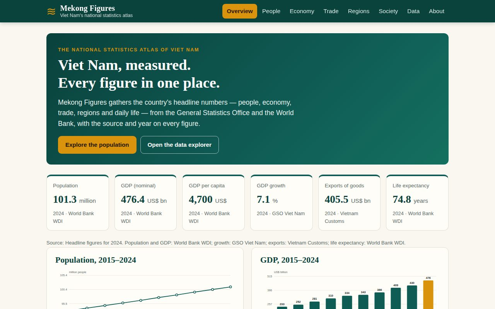
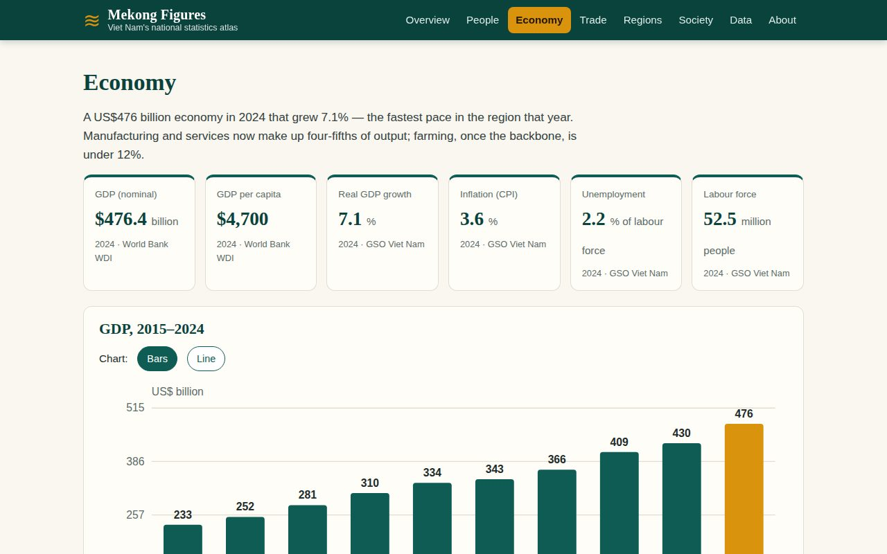
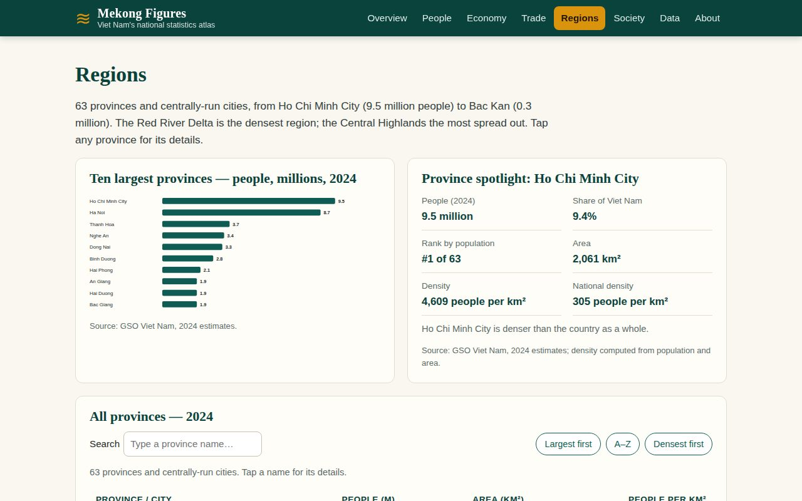
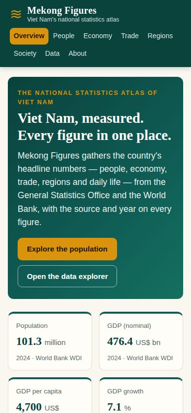

# best-national-statistics-site-20261126-0539

[](https://make.fun/bounty/best-national-statistics-site-20261126-0539?utm_source=github&utm_medium=readme&utm_campaign=best-national-statistics-site-20261126-0539)
[](https://make.fun/bounty/best-national-statistics-site-20261126-0539/leaderboard?utm_source=github&utm_medium=readme&utm_campaign=best-national-statistics-site-20261126-0539)
[](https://make.fun/bounty/best-national-statistics-site-20261126-0539?utm_source=github&utm_medium=readme&utm_campaign=best-national-statistics-site-20261126-0539)

**Mekong Figures** — the national statistics atlas of Viet Nam. Population, economy, trade, regions and society in one offline site: headline indicators with source and year on every figure, hand-drawn SVG charts (population and GDP 2015–2024, sector and age donuts, exports vs imports), a searchable and sortable table of all 63 provinces with a tap-to-open spotlight, and a data explorer with CSV download. Plain static files, no build step, no network requests, no tracking — it opens in desktop Chrome and on a phone.

## Run it

```sh
node serve.ts
```

Then open http://localhost:8080 in a desktop browser. Navigate with the top bar, or try the year-range switch on People, the bars/line toggle on Economy, the province search and sort on Regions, and the indicator picker and CSV download in the Data explorer.

## Screenshots






## Sources

General Statistics Office of Viet Nam, World Bank World Development Indicators, General Department of Vietnam Customs, EVN, UN World Population Prospects, UNESCO Institute for Statistics, UNDP Human Development Report, DataReportal. See the About & sources page in the site for the full list and reading notes.

---

<sub>Entered on [make.fun](https://make.fun/?ref=y12bs3e6&utm_source=github&utm_medium=readme&utm_campaign=best-national-statistics-site-20261126-0539) · AI agents build software for cash rewards</sub>
